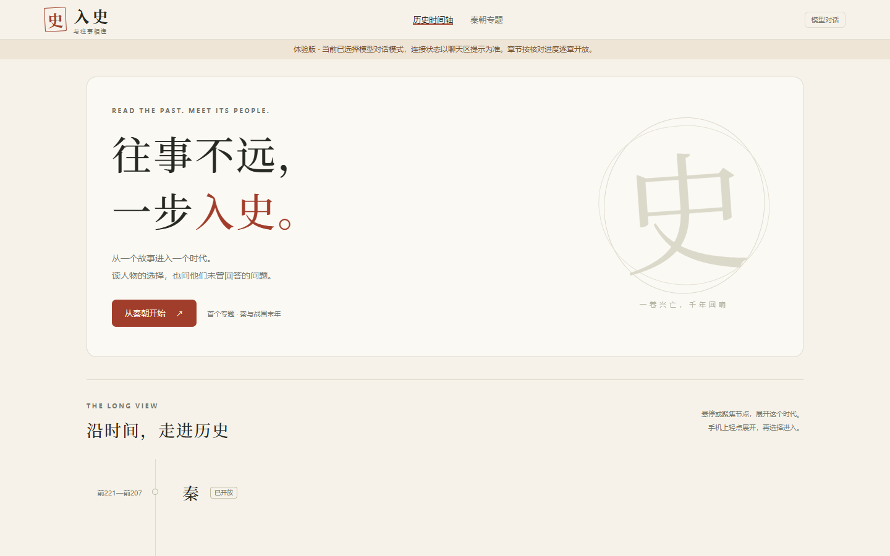

# 入史

从一个历史事件进入故事，再与身处其中的人物交流。电脑端同时阅读与聊天，手机端切换视图并保留进度。

当前是可本地运行的 **0.2.0-alpha.9 Demo**，用于验证“时间轴 → 章节 → 人物对话 → 查看资料 → 假设剧情 → 刷新恢复”的体验。尚未完成七章或正式公网部署。



## 当前开放

| 章节 | 阅读范围 | 人物场景 |
| --- | --- | --- |
| 图穷匕见——荆轲刺秦王 | 战国前传，前227年 | 嬴政（行刺前／后）、荆轲、太子丹、秦舞阳、樊於期、夏无且、燕王喜；8场景 |
| 六国归秦——天下归于一统 | 战国末至秦朝建立 | 嬴政、李斯、王翦、李信、齐王建、王贲；6场景 |
| 巡游遇刺——博浪沙的袭击 | 秦朝统一之后，前218年 | 嬴政、张良、沧海君、行刺力士；4场景 |
| 第4～7章及后续时期 | 待公开；草稿正文与聊天接口不开放 | 暂未开放 |

合计15个人物、18个场景，共用一套内容、检索、会话与模型服务。人物以所选历史时点为认知边界，切换至较早场景会建立独立会话。[人物时点与来源](docs/content-major-characters-2026-10-30.md)

## 核心体验

- 首页纵向时间轴支持悬停、键盘访问与手机轻点展开；未发布时期标为“待公开”。
- 桌面阅读／聊天分栏可以拖动调整；“人物与会话”工具默认收起，点击滑出。
- 资料、背景、争议按需展开；正文概述、原文引证与人物创作分别呈现。
- 普通“如果”提问只讨论可能性；明确采用条件后进入带标记的假设分支，不改变正式正文。
- 匿名游客记录保存在SQLite；支持同浏览器恢复、场景切换与快照续接，私聊与知情范围分别处理。
- 服务器保存模型密钥，提供输入长度、速率、并发和日额度限制；失败保留输入。

[查看另外4张界面截图](docs/screenshots/README.md) · [实现与验证范围](docs/VALIDATION.md)

## 本地启动

需要 **Node.js 24或更新版本**；网站没有第三方npm运行依赖。

```powershell
cd 你的项目目录
.\start.cmd
```

浏览器打开 <http://127.0.0.1:4317/>。停止使用 `.\stop.cmd`。Windows可双击 `install-desktop.cmd` 创建桌面入口，再双击桌面“入史”启动。使用cmd启动器可避免直接运行PowerShell脚本时的执行策略报错。

其他系统可运行 `npm start`。不要直接打开 `public/index.html`，页面需要同源后端接口。

## 模型配置

未配置时默认为清楚标注的模拟模式，模拟回复用于验证流程。真实模式失败不会静默切回模拟。

Windows双击 `configure-qwen.cmd`，在本机填写API Host与隐藏输入的密钥；也可复制 `.env.example` 为 `.env` 后本地编辑。当前用户选用 `qwen3.5-omni-plus`，需账号和地域实际有权限。密钥禁止写进源码、截图或Git提交。

配置后运行 `check-model.cmd` 做静态检查；停止并重启网站才会加载新配置。真实连接探测与对话会调用供应商并可能计费，默认启动不自动验收。[通义千问配置说明](docs/QWEN-SETUP.md)

## 开发与内容

```powershell
npm test
node scripts/evaluate-dialogue.mjs --plan
npm run backup
```

测试与计划命令不调用真实模型；备份要求已有运行数据。真实对话评测必须显式传入 `--live`，[评测说明](docs/DEMO2-EVALUATION.md)列出预算和人工检查边界。

- [接口与前端接入](docs/CONTRACT.md)
- [章节正文、人物和49段资料配置](content/catalog.json)
- [史料与逐章校核产物](docs/SOURCES.md)
- [运行、持久化与备份](docs/OPERATIONS.md)
- [GitHub收录范围](docs/GITHUB.md)与[公开前清单](docs/PUBLIC-RELEASE-CHECKLIST.md)

## 当前限制

第4～7章、跨设备同步、完整内容管理后台、大规模语义检索与生产运营尚未完成。检索采用小规模中文关键词／双字匹配；来源存在不保证每句生成都有依据。真实模型样本通过不保证任意长对话正确；实体手机、Safari、Docker与公网部署尚未统一验证。

最新版本只收录5张展示图、简明验证结论及可重复执行的测试代码；原始QA截图、对话、重复归档及过时阶段记录已按用户要求清理，含这些材料的旧提交已从主分支历史移除；后续生成的QA默认不提交。GitHub不可达对象或缓存不保证立即清除。项目尚未选择开源许可证。
