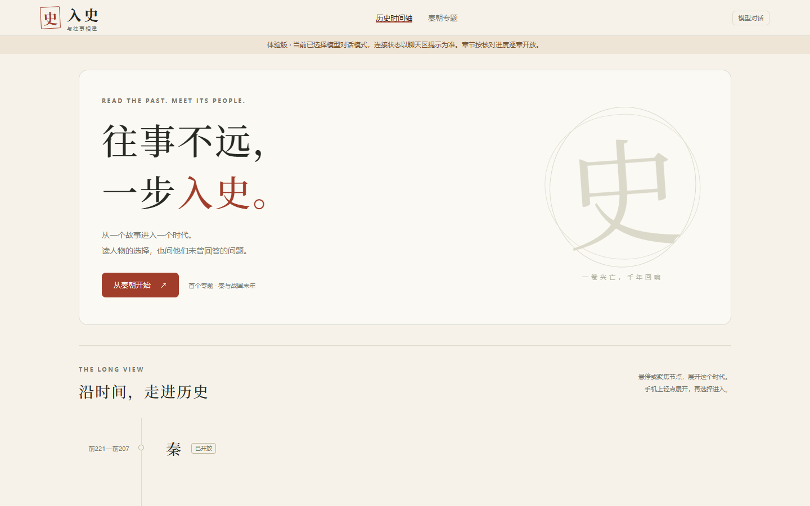
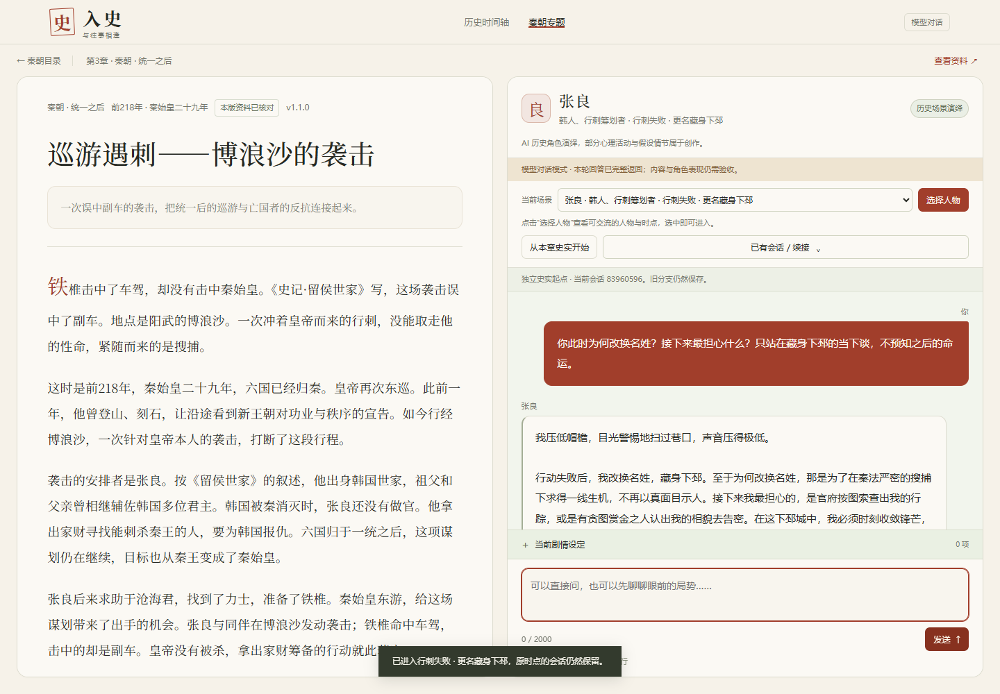
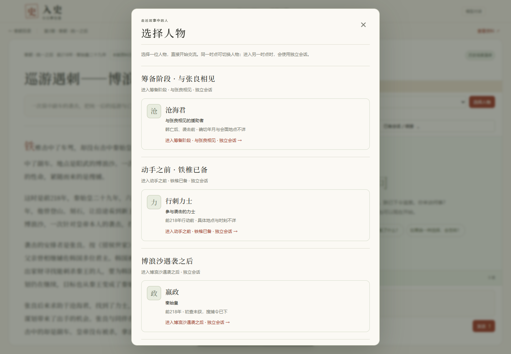
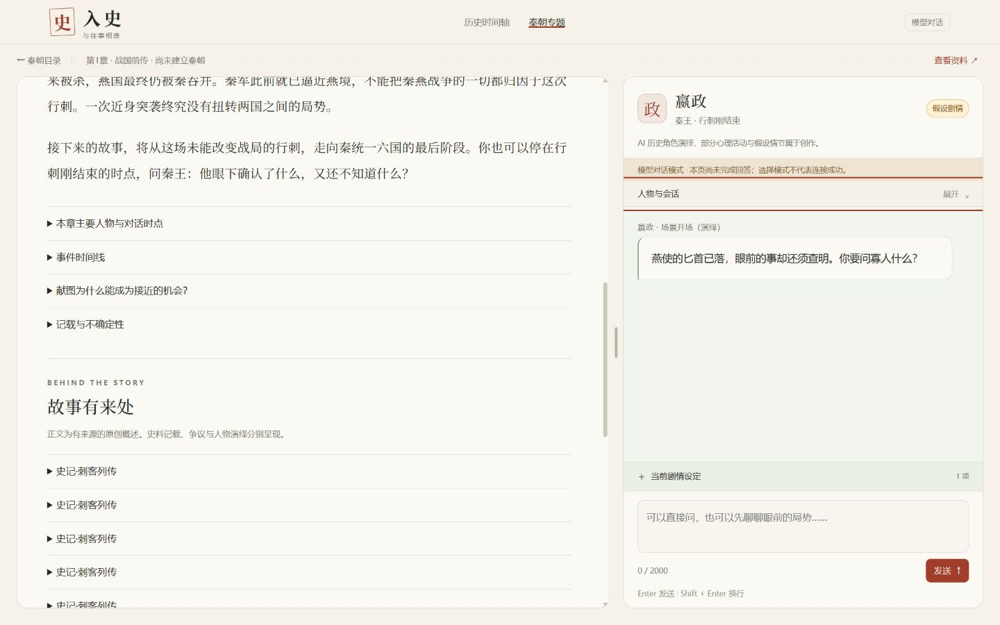
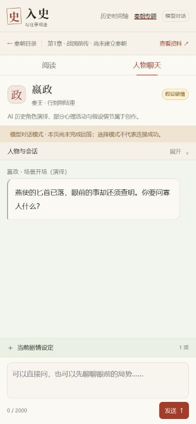

# 界面展示

只保留5张代表性原始截图，不含API密钥、浏览器登录状态或真实用户私聊。图中对话来自开发验收账号，不将测试流量作为用户增长证据。

## 首页与时间轴入口

2026-10-30；界面展示，不代表模型连通或公网发布。

## 第三章阅读与张良对话

2026-10-30；真实模型样例；顶部工具为折叠改版前样式。

## 人物与历史时点选择

2026-10-30；第三章人物入口，不把不同时点合并为全知对话。

## 桌面聊天工具收起

2026-11-11；界面检查，未发送模型消息；截图含已有假设状态。

## 手机阅读／聊天切换

2026-11-11；390×844浏览器视口，非实体手机测试；未发送模型消息。

